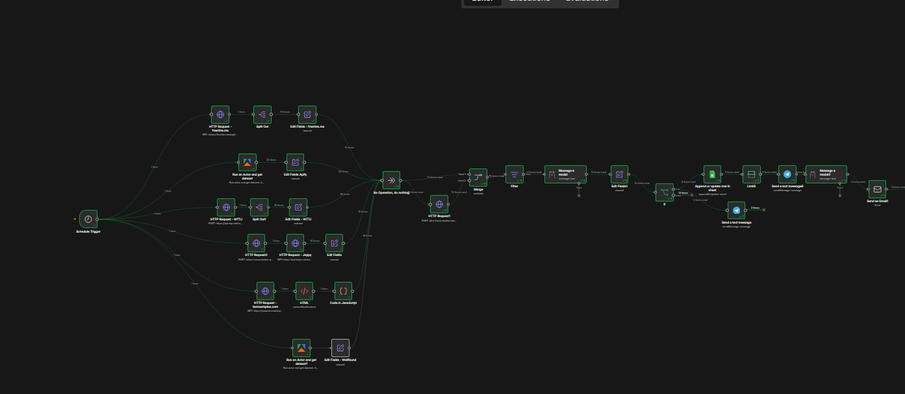
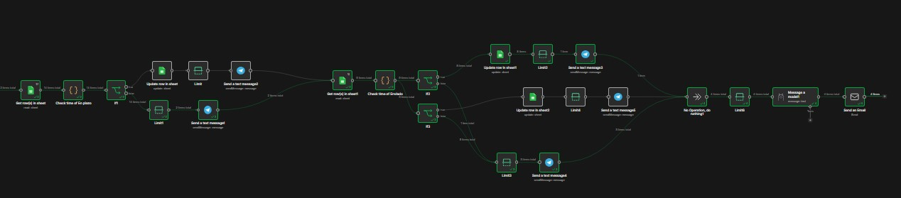

<p align="center">

[](https://github.com/L0cksat/n8n-job-monitor)
[](https://github.com/L0cksat/n8n-job-monitor/stargazers)
[](https://github.com/L0cksat/n8n-job-monitor/network/members)
[](https://github.com/L0cksat/n8n-job-monitor/commits/main)

</p>

<p align="center">

[](https://n8n.io/)
[](https://www.docker.com/)
[](https://ollama.com/)
[](https://telegram.org/)
[](https://www.google.com/sheets/about/)
[](https://apify.com/)

</p>

# Automated AI Job Search (n8n, Ollama, Telegram & Google Sheets)

A self-hosted **n8n** workflow that collects job listings every morning, scores them with a local **Ollama** model (`llama3.1`), and keeps a living application tracker in **Google Sheets**. Matches go out as Telegram alerts and email. Open applications get follow-up reminders, including a flag when a company has gone quiet.

The workflow is exported as [`AI Job Search Custom.json`](AI%20Job%20Search%20Custom.json) and runs in Docker.

## Features

- **Six sources in one run:** [freehire.me](https://freehire.me), LinkedIn (Apify), Welcome to the Jungle, Joppy, Tecnoempleo, and Wellfound (Apify).
- **Local AI filter:** Ollama acts as a CTO reviewer. It keeps junior and mid full-stack and AI-automation roles that are remote or based in the Valencian Community, and drops senior-only roles and unrelated stacks.
- **Google Sheets tracker:** New matches are appended, and later steps update status as applications age.
- **Telegram alerts:** Each approved role arrives with title, company, salary, source, the model's reason, and a direct link.
- **Email:** A same-day digest of new rows, plus a daily briefing that summarizes the sheet.
- **Follow-ups:** Applications sent 2–14 days ago stay in the follow-up window. At 15 days with no reply, the workflow marks them as ghosted and notifies Telegram.
- **Self-hosted:** n8n runs in Docker. The model stays on your machine.

## Tech stack

| Piece | Role |
| --- | --- |
| [n8n](https://n8n.io/) | Schedule, HTTP, HTML extract, Code, Sheets, Telegram, and email |
| [Ollama](https://ollama.com/) `llama3.1` | Fit score and the HTML digest |
| [Apify](https://apify.com/) | LinkedIn Jobs Scraper and Wellfound Jobs Scraper |
| Google Sheets | Tracker (`appendOrUpdate` and status updates) |
| Telegram Bot API | Instant alerts and reminders |
| SMTP | Digest and daily briefing |
| Docker Compose | n8n on port `5678` |

## Demo

**Search, scoring, and alerts**



The schedule fans out to all six boards. Listings are normalized, merged, scored, written to the sheet, and sent to Telegram and email.

**Follow-ups and the daily briefing**



Screen recordings in this repo:

- [Full search run](n8n-ai-job-search1.mkv)
- [Telegram and email messages](n8n-ai-job-search-messaging.mkv)

## Getting started

### Prerequisites

- [Docker](https://www.docker.com/) with Docker Compose.
- [Ollama](https://ollama.com/) on the host, with `llama3.1` pulled. The workflow calls it at `http://host.docker.internal:11434`.
- A Telegram bot token from [@BotFather](https://t.me/botfather), and the chat id that should receive alerts.
- A Google Cloud project with the Sheets API enabled, and OAuth2 or a service account that can edit your tracker.
- An [Apify](https://apify.com/) API token. In n8n, install the community node `@apify/n8n-nodes-apify` before you open the workflow.
- SMTP credentials for the digest and briefing.
- Access to the Joppy explorer API if you keep that branch enabled.

### Installation

1. Clone the repository:

   ```bash
   git clone https://github.com/L0cksat/n8n-job-monitor.git
   cd n8n-job-monitor
   ```

2. Start n8n:

   ```bash
   docker compose up -d
   ```

   Open [http://localhost:5678](http://localhost:5678).

3. Install the Apify community node (`@apify/n8n-nodes-apify`) from **Settings → Community nodes**, then restart n8n if the UI asks you to.

4. Import the workflow:

   - **Workflows → Import from File**
   - Select `AI Job Search Custom.json`

5. Connect your own credentials on every node that shows a missing credential:

   - Telegram bot
   - Google Sheets (point both the append and the update nodes at your spreadsheet)
   - Apify
   - Ollama (`llama3.1`)
   - SMTP

6. Pull the model on the host if you have not already:

   ```bash
   ollama pull llama3.1
   ```

The schedule trigger runs every day at **09:00**. Telegram uses polling, so a public webhook URL is optional. `docker-compose.yml` has a commented `WEBHOOK_URL` if you later switch the bot to webhooks.

## How it works

1. **Schedule Trigger** starts the run at 09:00.
2. **Collect.** Parallel branches call freehire.me, the LinkedIn Apify actor, the Welcome to the Jungle GraphQL API, Joppy, Tecnoempleo (HTTP request plus HTML extraction and a Code node), and the Wellfound Apify actor.
3. **Normalize and merge.** Set nodes map every source to the same fields: title, company, url, description, salary, and source.
4. **Score.** The Ollama node (`llama3.1`) returns a JSON verdict (`APROBADO` or `RECHAZADO`) and a short reason. An If node keeps the approved rows.
5. **Track.** Google Sheets appends or updates the row so the same listing is not treated as new forever.
6. **Notify.** Telegram sends the approved role. A second Ollama call turns the day's new rows into an HTML email.
7. **Follow up.** Later branches read the sheet, count days since `Fecha Enviada Solicitud`, ping Telegram while the application is still in the 2–14 day window, and mark ghosting after 15 days.
8. **Briefing.** A final Ollama pass plus an email node sends the daily CTO briefing from the sheet.

## Author

[](https://github.com/L0cksat)
[](https://www.linkedin.com/in/stephen-nicholas-jones-de-giorgi-50668449)
[](https://stephennicholasjones.com)
